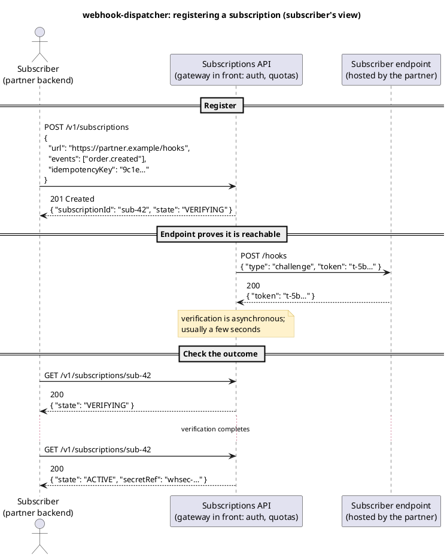

# PlantUML recipe: sequence figures

Sequences show the **caller's experience**: each request the actor sends and
each answer it gets, including waits on asynchronous work and the actual
payloads. Topology (what is connected to what) belongs in an architecture
figure instead.

## Contents

- [One-time setup](#one-time-setup)
- [Starter source](#starter-source)
- [Keeping it the caller's view](#keeping-it-the-callers-view)
- [Pitfalls](#pitfalls)
- [Other PlantUML diagram types](#other-plantuml-diagram-types)

## One-time setup

PlantUML runs on Java. Sequence figures do not need Graphviz.

```bash
brew install plantuml                         # macOS: installs the `plantuml` command
sudo apt-get install -y default-jre-headless  # Debian/Ubuntu: Java only; use the jar below
```

For identical output on every OS, run a pinned jar from the public upstream
releases, and write the version you used next to the source:

```bash
PLANTUML_VERSION=1.2024.7
mkdir -p ~/.local/lib
curl -fsSL -o ~/.local/lib/plantuml.jar \
  "https://github.com/plantuml/plantuml/releases/download/v${PLANTUML_VERSION}/plantuml-${PLANTUML_VERSION}.jar"
java -jar ~/.local/lib/plantuml.jar -version
```

Export to PNG; the `.puml` file stays the source:

```bash
plantuml -tpng subscribe-sequence.puml     # or: java -jar ~/.local/lib/plantuml.jar -tpng subscribe-sequence.puml
```

## Starter source



## Keeping it the caller's view

- **Draw the replies** (`API --> S`) as well as the requests. The reader
  should see "I send this; I get that".
- **Mark the waits.** Use a delay line (`... verification completes ...`)
  between the first answer and the poll that sees the final state, so the
  start, the polling, and the result are all visible.
- **Use real payloads.** Message labels carry the actual fields from the
  contract. For an update, show what the body contains (entries to add,
  change, or remove) rather than something like `update(id, changes)`.
- **Hide plumbing the caller cannot see.** Fold the gateway into the API
  participant's name instead of giving it its own lifeline; the architecture
  figure shows it separately.
- **Group with `==` headings,** and use `note over X` for a short remark on
  what happens behind a step.

## Pitfalls

- **Outdated skinparams stamp a warning onto the image.** One example is
  `skinparam ParticipantPadding`, which prints a notice telling you to switch
  to style blocks across the top of the PNG. Leave such params out, and check
  the render for any others.
- JSON in labels makes tall message boxes; that is expected. Show arrays as a
  representative sample (`[ … ]`), not in full.
- A `... text ...` delay has to be on a line of its own.
- Non-ASCII characters need the source saved as UTF-8; pass `-charset UTF-8`
  if the export shows garbled text.

## Other PlantUML diagram types

PlantUML can also draw component, deployment, state, and entity diagrams, and
public sprite libraries (such as `aws-icons-for-plantuml`) add cloud icons.
Use it here for sequences, which is where it is strongest; `../SKILL.md`
§ Scope sends topology to draw.io or Python `diagrams`.
